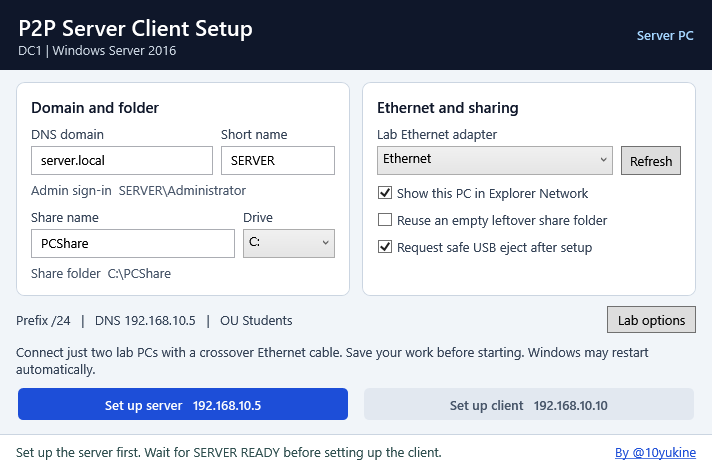

# P2P Server Client Setup

P2P Server Client Setup is a Windows helper for an isolated two-PC networking lab. It connects one Windows Server and one Windows client directly over Ethernet, creates an Active Directory domain, and sets up a shared folder on each PC. Here, **P2P** means the two PCs connect directly and can access each other's shares. Active Directory still runs on the server.

## Lab scope

> **Use this helper with exactly two lab PCs connected directly by a crossover UTP Ethernet cable.** Disconnect Wi-Fi, VPNs, and other network links first. Keep the crossover cable off your office, school, and home networks.
>
> The helper replaces IPv4 settings on the selected adapter, assigns the configured static IPs, and may restart Windows. It is intended for disposable or backed-up lab machines. Switch-based setups, shared networks, and deployments with more than two PCs are outside the recommended setup and have not been verified here.

## What it sets up

- A domain controller with AD DS and DNS on the server, then a domain join on the client.
- A folder shared by each PC over SMB, with access for a dedicated domain group.
- Optional discovery in File Explorer and safe USB ejection when Windows supports it.
- Editable IPv4 addresses, subnet prefix, and optional gateway. Both PCs use the server as their DNS server.
- Optional server DHCP scope, organizational unit (OU), and lab users. Existing user passwords are kept.
- Automatic restarts where required, with a temporary scheduled task that resumes setup after an administrator signs in.

## Before you start

- Connect the two lab PCs directly using a tested crossover UTP Ethernet cable. Check the link lights on both PCs before opening the helper.
- Use Windows Server 2012 R2 or later with a graphical desktop and Windows 10 or later Pro, Enterprise, or Education on the client. Both PCs need working Ethernet drivers and administrator access.
- Open **Setup-GUI.bat** to check compatibility and enable the matching setup button. The helper uses the built-in Windows PowerShell, including 4.0 on stock Server 2012 R2.
- Name the PCs before creating or joining the domain. `SERVER01` and `CLIENT01` work well.
- Save open work. Domain setup may restart Windows automatically.

| Default setting | Server | Client |
| --- | --- | --- |
| IPv4 | 192.168.1.1 | 192.168.1.2 |
| Subnet mask | 255.255.255.0 | 255.255.255.0 |
| DNS | 192.168.1.1 | 192.168.1.1 |
| Default gateway | Blank | Blank |

## Quick start

1. Download the repository from **Code → Download ZIP** and extract it to a USB or local folder. Keep `Setup-GUI.bat` beside `_assets`.
2. Open **Setup-GUI.bat** on the server. Choose the DNS domain, short name, connected Ethernet adapter, share name, and an NTFS drive. For example, use `server.local`, `SERVER`, and `PCShare`. Click **Set up server**.
3. Follow the password and sign-in prompts. After a restart, sign in with the account shown in the setup window. Wait for **SERVER READY** and leave the server running.
4. Open the helper on the client with the same domain and short name. Click **Set up client**, then use the server’s domain Administrator credentials to join. Sign in as a domain administrator after restart and wait for **CLIENT READY**.
5. Test access from both machines. In File Explorer, open `\\192.168.1.1\PCShare` on the client and `\\192.168.1.2\PCShare` on the server. Replace `PCShare` if you chose another share name. If prompted, use the domain’s `shareuser` account.

Create a disposable file in each remote share and check that it appears on the other PC. The shares are separate folders.

For a custom network or classroom assessment, open **Lab options** before starting and use the same values on both PCs. Enter User 1's display and sign-in names separately. Check **Add User 2 (optional)** only when you need a second account.

See the [assessment walkthrough](docs/assessment.md) for example settings, password prompts, and the manual Folder Redirection and Windows Server Backup steps.

## Troubleshooting

| If you see | Try |
| --- | --- |
| A message says Windows PowerShell 5.1 is required | Replace both `Setup-GUI.bat` and the scripts in `_assets` with the current version. If you have a saved `_assets/setup-config.json`, keep it. |
| No Ethernet adapter | Check the cable and link lights, then click **Refresh**. |
| Domain cannot be found | Confirm the server reached **SERVER READY** and both PCs use the same domain name. |
| PC absent from Explorer Network | Open its direct address. Explorer discovery depends on Windows and the network. |
| A leftover share folder | Use **Reuse an empty leftover share folder** for an empty folder. Choose a different share name if it contains data. |
| Resume appears stuck | Sign in as the Administrator indicated by setup. If it fails, save the on-screen message and the recovery path. |

If your PC blocks an unsigned PowerShell script, follow your organization’s policy for reviewed scripts.

## How it works

`Setup-GUI.bat` opens the WPF interface in `_assets/Setup-GUI.ps1`. Edits autosave to `_assets/setup-config.json` beside the scripts after a short pause. In **Lab options**, click **Apply lab options** to save. Close the GUI and safely eject the USB before moving it to the next PC. Confirm the local Ethernet adapter and share drive there.

The GUI launches `_assets/Run-Setup.ps1` with administrator approval. Passwords are entered interactively and stay out of the saved settings. The worker uses Windows services and administrative commands for network configuration, AD DS, SMB, and Task Scheduler.

After success, the helper removes its temporary resume task and staged files and leaves a summary under `%ProgramData%`. A failed run can leave some changes in place, so read its recovery message before retrying. The static addresses are for a two-PC lab. Use separate deployment planning and addressing for more machines.

## Credits

Created and maintained by [@10yukine](https://github.com/10yukine).
