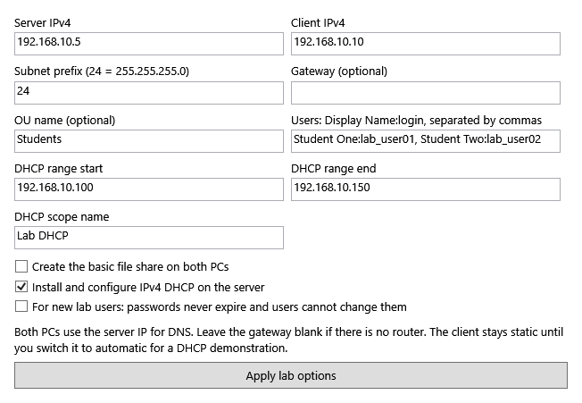
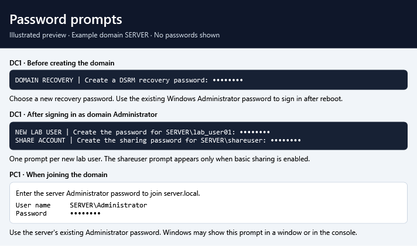

# Assessment walkthrough

Use two isolated PCs connected directly by crossover UTP. The helper replaces IPv4 settings and may restart Windows. If you are remote, arrange console access or someone on-site first.

## Configure the helper

1. Rename the server and client before domain setup. The example uses `DC1` and `PC1`.
2. Open `Setup-GUI.bat` on the server. Enter your assigned DNS domain and short name. The screenshots use `server.local` and `SERVER` as generic examples.
3. Open **Lab options** and enter the values from your assessment.

| Field | Example |
| --- | --- |
| Server IPv4 | `192.168.10.5` |
| Client IPv4 | `192.168.10.10` |
| Subnet prefix | `24` for `255.255.255.0` |
| DNS | Both PCs use the server IPv4 address automatically |
| Gateway | Blank on a direct cable. Enter `192.168.10.1` if the rubric explicitly requires it. |
| OU and users | `Students` and `Student One:lab_user01, Student Two:lab_user02`. Use the assigned names and logins. |
| DHCP | Enable if required. Enter the assigned scope name and range, e.g. `192.168.10.100` to `192.168.10.150`. |
| Basic sharing | Optional. Folder redirection uses its own dedicated share. |
| Lab password rules | Enable only for new lab accounts if both password settings are required. |

Click **Apply lab options** and **Set up server**. Starting setup saves the options locally. Use the same USB on the client and confirm the same domain, address settings, and options before clicking **Set up client**.

## Password prompts

- **Domain recovery:** On the server's first run, choose a DSRM recovery password.
- **Administrator sign-in:** After domain promotion, use the server's existing Administrator password with the domain Administrator account.
- **New lab user:** Create a password for each new account on the server.
- **Share account:** Create the separate `shareuser` password if basic sharing is enabled.
- **Join domain:** On the client, enter the server's existing Administrator password. Windows may show the credential prompt in a window or in the console.

## Verify and finish in Windows

1. **DHCP lease:** Wait for **SERVER READY** and **CLIENT READY**. The client starts with the assigned static address. To demonstrate DHCP, open `ncpa.cpl` on the client, set its lab Ethernet adapter to obtain both IP and DNS automatically, and run `ipconfig /all`. Restore the static IP and DNS before testing shares or folder redirection. The helper scopes file-sharing firewall rules to the assigned static peer.
2. **Folder redirection:** Create a dedicated share such as `\\DC1\Students$` using [Microsoft's per-user share permissions](https://learn.microsoft.com/en-us/windows-server/storage/folder-redirection/deploy-folder-redirection). Link a new GPO to the OU you entered. Edit **User Configuration → Policies → Windows Settings → Folder Redirection**. For **Desktop** and **Documents**, select **Basic → Create a folder for each user under the root path** and enter the share path. Sign in as each lab user on the client and confirm test files land in separate server folders.
3. **Backup and restore:** Create `C:\Files` with a test file on the server. Add the built-in **Windows Server Backup** feature if needed. Choose **Backup Once → Custom**, add `C:\Files`, and select `D:` as the target. In **Recover → Files and folders**, restore to a separate folder and open the recovered file. [Microsoft backup reference](https://learn.microsoft.com/en-us/windows-server/administration/windows-commands/windows-server-backup-command-reference)

The helper prompts for passwords at runtime and saves none in its settings. It refuses to replace a different DHCP scope. Review the existing role and scope in DHCP Manager before changing them. If setup stops after making changes, keep the console error and recovery path.
